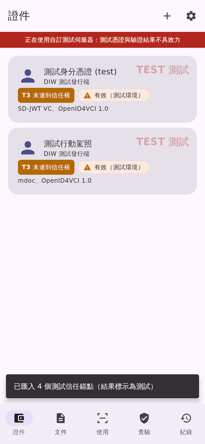
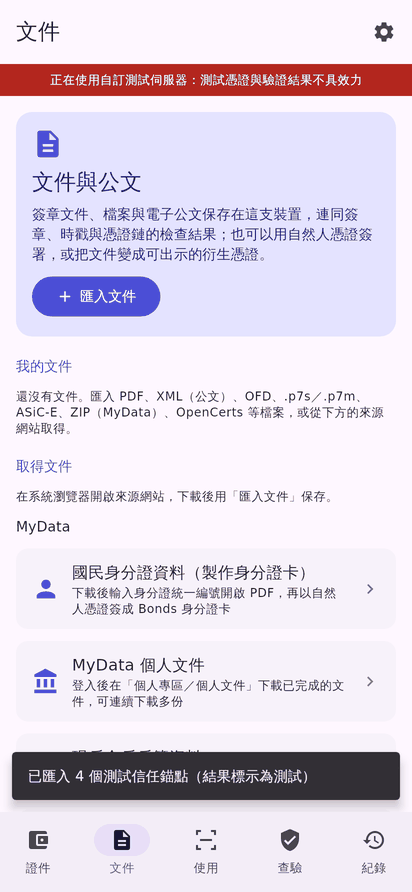
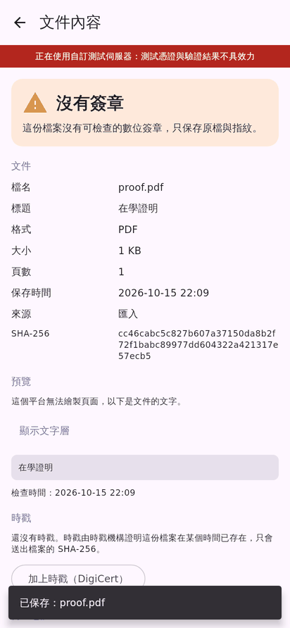
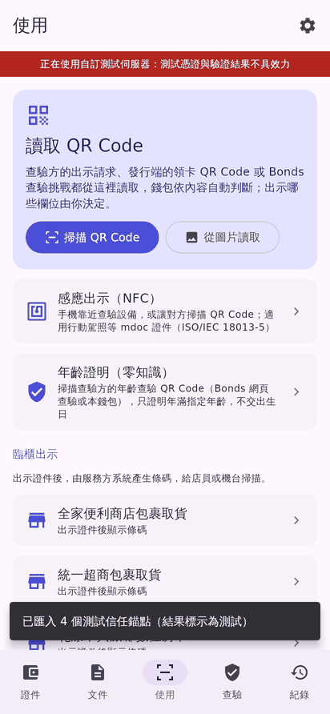
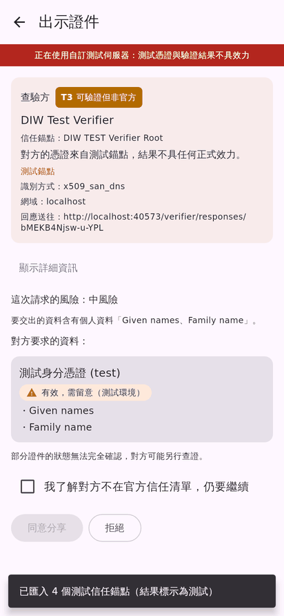
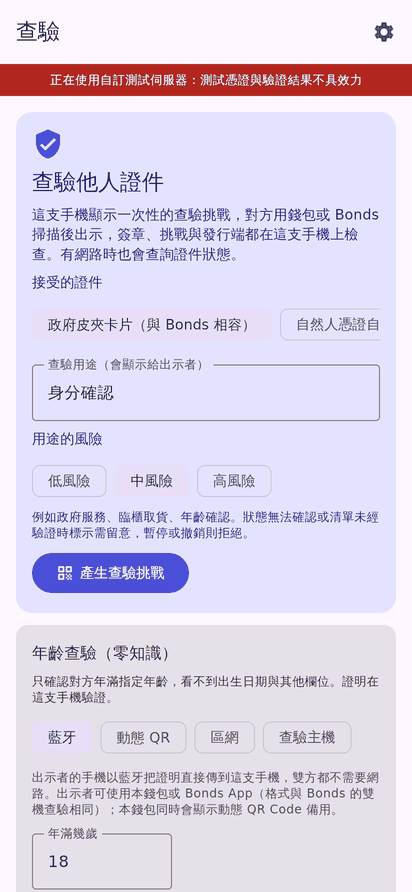
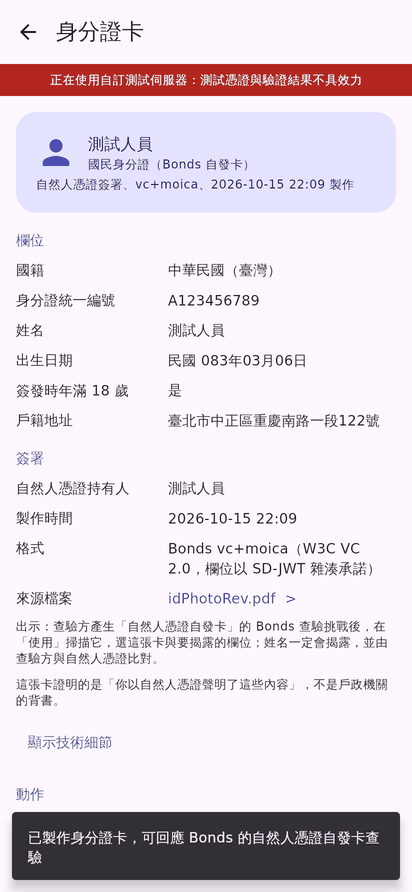
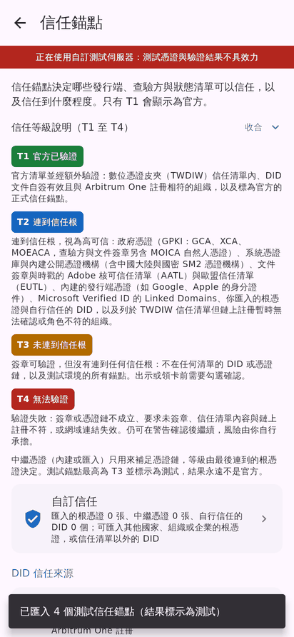

# DIW MY WALLET

跨平台的整合數位皮夾：在同一個 App 內持有與出示數位憑證、查驗他人的證件、保存並檢查簽章文件、以自然人憑證或遠端簽章服務簽署，並把文件轉成可出示的衍生憑證。

以標準協議為核心（OpenID4VCI / OpenID4VP 1.0、SD-JWT VC、ISO mdoc），並完整相容台灣數位憑證皮夾（TWDIW）、Bonds、Microsoft Entra Verified ID 與 EUDI 參考實作。底層使用 [Multipaz](https://github.com/openwallet-foundation/multipaz)，介面以 Compose Multiplatform 撰寫，目前提供 Android 與 Windows、Linux 桌面版。

> 狀態：開發中（P4 零知識證明：年齡證明、網站查驗證明與 mdoc 零知識出示已可使用，zkPDF 開發中）。正式與測試環境在同一個 App 內，測試環境的結果一律標示為不具效力。

## 畫面

| 證件 | 文件 | 文件內容 | 使用 |
|---|---|---|---|
|  |  |  |  |
| **出示同意** | **查驗** | **Bonds 身分證卡** | **信任錨點** |
|  |  |  |  |

畫面由 `app/src/desktopTest` 以測試資料離屏繪製（見[建置與測試](#建置與測試)），內容皆為虛構。

## 介面設計

介面依 EUDI Wallet 與 Bonds 的設計：所有證件在同一份清單，各發行端與 Profile 的功能併入共同的流程，不為個別發行端另開專區。

- **五個分頁**
  - **證件**：所有證件同一份清單，可分組、搜尋與篩選。
  - **文件**：保存、檢查、加時戳、簽署、產生衍生憑證，以及從來源網站取件。
  - **使用**：掃描出示、感應出示、臨櫃條碼與加入證件。
  - **查驗**：App 作為查驗方。
  - **紀錄**：只記欄位名稱，不記內容。

  設定在右上齒輪，依用途分為安全與隱私、證件與出示、文件與簽章、信任、互通、開發者與測試、顯示、關於八組，清單上直接顯示各組目前的設定。
- **信任一眼可辨**：發行端、查驗方與文件簽署者都標示信任等級。
  - **T1**：官方清單並經額外驗證。
  - **T2**：連到信任根，視為高可信。
  - **T3**：可驗證但沒有連到信任根，以及所有測試錨點。
  - **T4**：驗證失敗。

  測試環境另有紅色橫幅與浮水印。低信任的操作不會被禁止，列出風險並勾選承擔後即可繼續。
- **判定用顏色、符號與文字三者並用**：綠色為通過，橙色為需留意，紅色為不應接受；「部分」不會看起來像「通過」。
- **出示前說清楚**：同意畫面顯示查驗方身分、信任錨點、查驗方附上的註冊憑證（verifier_info）檢查結果、提供資料的對象、用途與知情同意書（TWDIW）、請求風險（依欄位敏感度與查驗方信任等級）與要交出的欄位。有多張證件符合時可「更改憑證」。證件被判定為不接受時不能出示。
- **QR Code 可從圖片讀取**：除了相機掃描，也可選擇截圖或照片讀取 QR Code；電腦版沒有相機時直接從圖片讀取。
- **不隱藏未完成的功能**：尚未提供的功能顯示為停用列並寫明原因，例如公文交換收發、zkPDF 證明與線上查驗（OpenID4VP）。
- **空狀態附直達動作**：結果以畫面或判定卡呈現，對話框只用於確認有後果的動作。

## 功能

### 數位憑證

- **領取**：OpenID4VCI 1.0 與 draft 11 至 13。支援：
  - pre-authorized code（含交易碼）與 authorization code（PKCE、PAR）；
  - DPoP、錢包證明、批次與延遲發證、回應加密；
  - 用戶端驗證依授權伺服器中繼資料選擇錢包證明（`attest_jwt_client_auth`）、`private_key_jwt` 或公開用戶端；正式錢包後端（Wallet Provider）可在「設定 > 互通」設定，須先向發證端註冊。
- **格式**：ISO mdoc、IETF SD-JWT VC、W3C VC（JWT、JSON-LD、Data Integrity、包在 SD-JWT 中的 W3C VC）。
- **Digital Credentials API**：瀏覽器與其他 App 可經系統選擇器要求出示，也可要求存入證件（OpenID4VCI）。
- **出示**：OpenID4VP 1.0（DCQL、transaction data 含 mdoc、DC API 的未簽章、簽章與多重簽章請求）與舊版草案（Presentation Exchange、SIOPv2），以及 ISO/IEC 18013-5 近距離出示（NFC、QR Code 交握，BLE 或 NFC 傳輸）與 18013-7 Annex B、C。
- **查驗**：以 NFC、USB 讀卡機或電腦 PC/SC 讀卡機讀取 mdoc；離線挑戰查驗 Bonds 相容證件與文件衍生憑證；年齡證明與官方網站即時查驗（見[零知識證明](#零知識證明)）。
- **狀態**：支援 IETF Token Status List、W3C Bitstring Status List、Status List 2021 與 Revocation List 2020，顯示規格原文的狀態。背景自動更新，依用途風險決定是否接受。
- **信任**：
  - X.509 信任錨點：政府憑證 GPKI、系統憑證庫、內建公開根憑證含中國大陸 CA 與國密 SM2（含 e簽寶公布的合作 CA，每月自動更新）、使用者匯入；中繼憑證（內建或匯入）只補足憑證鏈；
  - 文件簽章與時戳另可依 Adobe 核可信任清單（AATL）與歐盟信任清單（EUTL），清單在 App 內驗證後離線保存並每週更新；
  - mdoc 簽署清單：VICAL（發行端）與 RICAL（查驗方），須由使用者指定的清單發行者根憑證簽署，過期不再採用；
  - DID：did:key、did:jwk、did:web、did:ion；
  - DIF Linked Domains、TWDIW 信任清單與 Arbitrum 鏈上錨定、使用者自行信任的 DID。
  - 自己匯入的根憑證、中繼憑證、mdoc 簽署清單與信任的 DID 集中在「設定 > 信任 > 自訂信任」，可隨時加入或移除。

### 文件與簽章

- **保存與檢查**：
  - 支援 PAdES、CAdES（.p7s / .p7m）、XAdES 與 XMLDSig、ASiC、電子公文線上簽核（.si）、OFD 與 SES 電子印章、RFC 3161 時戳、OpenCerts、國密 SM2；
  - 每個簽章分別顯示完整性、憑證鏈信任、時戳與簽署後的變更；
  - 相同內容自動去重，同類的分年度文件可並存，並依項目整理。
- **時戳與撤銷資訊**：可選擇 TSA，保存時可自動加時戳；時戳機構與文件內簽署者的憑證鏈和撤銷資訊（OCSP 優先，取不到才用 CRL）一併保存，公文容器可一次取得全部檔案的撤銷資訊；時戳可移除後重新取得；開啟文件時依目前的信任錨點重新判定。
- **簽署**：
  - 方式：自然人憑證卡（Android NFC、USB 或 PC/SC 讀卡機）、PKCS#12、錢包金鑰；
  - CSC v2 遠端簽章：內建 EUDI 測試服務，也可自行加入服務；
  - 格式：PDF 以 PAdES 增量簽署，XML 以 XAdES，其他檔案以 CAdES 或 ASiC-E，電子公文在線上簽核檔（.si）加簽核點；
  - 保證層級：PAdES、CAdES、XAdES、ASiC-E 都可選 B-B、B-T（簽章時戳）、B-LT（再加憑證鏈與撤銷資訊，OCSP 優先）、B-LTA（再加保存時戳），簽完顯示實際達到的層級；
  - PDF 可選認證簽章（不允許變更、只允許填表、允許填表與註解），已簽署的 PDF 可「延長保存」補上長期驗證資料與文件時戳；
  - 簽署畫面可展開技術細節；簽出的檔案以 EU DSS 交叉驗證。
- **預覽與結構化解析**：
  - 可預覽 PDF（含加密 PDF）、圖片、XML、文字與 .p7m 內含的內容；
  - 以結構化畫面呈現電子公文「函」與線上簽核、OpenCerts 證書、台灣入出國日期證明書、中國大陸出入境記錄、通行證關聯查詢結果、在學證明與戶籍謄本（可切換住戶，本人優先）；
  - OpenCerts 證書可離線顯示：OpenCerts 範例顯示程式的樣式內建於 App，其他證書由錢包排版，內容不離開手機。
- **電子公文容器**：
  - .di 與交換表單、簽核檔、附件（含 .doc 與 TIFF 頁面影像）放在同一個容器；
  - 匯入的壓縮檔含簽核檔（.si）時，依簽核檔建立容器並放入它簽署的檔案，其餘檔案列出依據由使用者確認；
  - 容器內依簽核點分兩層，每個檔案列在第一個簽署它的簽核點下，並顯示檔案是否齊全、與簽核時是否相同、簽核點簽章與撤銷資訊；
  - 簽署公文時依文書及檔案管理電腦化作業規範在簽核檔加一個簽核點，涵蓋公文與附件，原檔不改動；驗證時列出不符規範之處，例如非 RSA-SHA256 或臨時憑證尚未補簽追認；
  - 刪除公文時可選擇一併刪除容器內的檔案。
- **匯出**：單一檔案可另存原檔，或連同時戳（.tsr）、憑證、OCSP 與 CRL 匯出成壓縮檔；公文容器匯出成壓縮檔，檔案保留原檔名，附證據與依簽核點整理的說明。
- **衍生憑證**：任何文件都可轉成 SD-JWT VC，欄位從文件內容解析，並附上三種證據：
  - 文件簽章檢查；
  - 時戳；
  - 自然人憑證簽章（與 Bonds vc+moica 相容）。
- **取件入口**：MyData（下載後自動解壓、命名並解析）、MyDoc、教育部大專校院數位證書、戶政、地政、移民署、財政部稅務入口網。

### 零知識證明

證明只交出查驗方要的結論或欄位，信任等級沿用原本的發行端或網站，不因零知識證明而提高。

- **年齡證明（OpenAC，與 Bonds 相容）**：以 TWDIW 有生日欄位的卡片或 Bonds 身分證卡，證明出生日期不晚於查驗方給的日期，不交出生日。可回應 Bonds 網頁的年齡請求；查驗方可用本 App 經主機、藍牙、同一個區域網路或動態 QR 查驗，Bonds App 與本 App 可互相查驗。
- **官方網站即時查驗（zkTLS，TLSNotary）**：持有人用手機連到官方查詢頁（學信網學籍報告、移民署入出國日期證明書），查驗方只看到查詢結果與指定欄位，看不到持有人輸入的證號；查驗方可以是另一支手機（區域網路或中繼）或電腦版。查詢結果可存成網頁證明證件，之後再出示。查驗頁以簽章的版型包發佈與更新。
- **mdoc 零知識出示（Longfellow）**：近距離與 Digital Credentials API 的 mdoc 請求明確要求時，以零知識證明出示指定欄位，不揭露 MSO 與簽章。
- **算力不足時由使用者選擇**：顯示估計時間，可仍在這台裝置產生、在電腦版產生，或不加零知識證據。
- **zkPDF**（開發中）：證明已簽署 PDF 第 1 頁寫著指定欄位，不交出整份文件。

### 相容（常駐啟用）

- **數位憑證皮夾（TWDIW）**：官方發證與出示流程、發行端卡面與身分保證等級（IAL）、出示時更改憑證與知情同意書、卡片目錄、臨櫃離線條碼、信任清單與 Arbitrum 錨定。
- **Bonds**：
  - 輪播 QR 與藍牙離線出示，以及作為查驗方（本 App 之間另可走區域網路與動態 QR）；
  - 年齡證明（OpenAC）的出示與查驗；
  - 以自然人憑證簽署的身分證卡（NationalIDCredential，vc+moica）與線上出示；
  - 擴充來源 `a`，可出示任何綁定金鑰的證件。
- **Microsoft Entra Verified ID**：`openid-vc://` 發行與出示、Linked Domains、Identity Hub 狀態清單。
- **EUDI**：參考實作的發證、PID 出示，以及 CSC 遠端簽章的 `qes-approval` 授權。

各方言只在對方使用該方言時介入，程式碼與標準路徑隔離。

## 下載

main 每次更新後，CI 發佈「nightly」預先發行版。

- **Android**：Android 10（API 29）以上。release APK 經 R8 最佳化；debug APK 允許連到區網測試伺服器的 HTTP。
- **桌面版**：Windows（.msi）與 Linux（.deb）安裝檔，內含 Java 執行環境；其他系統可用 Java 21 執行 jar。

檔案說明與簽章方式見 [docs/release.md](docs/release.md)。

## 建置與測試

需求：JDK 21、Android SDK（compileSdk 36）。

```bash
./gradlew :app:assembleDebug          # Android debug APK
./gradlew :app:assembleRelease        # Android release APK（R8）
./gradlew :app:run                    # 桌面版
./gradlew :test-servers:test          # 協議、互通、文件與方言測試
./gradlew :app:desktopTest            # App 流程測試
DIW_SCREENSHOTS=build/shots ./gradlew :app:desktopTest --tests '*uiScreenshots'   # 繪製主要畫面
```

- **Windows**：PowerShell 先執行 `chcp 65001`，並設定 `$env:JAVA_TOOL_OPTIONS="-Dfile.encoding=UTF-8"`。
- **桌面版的感應查驗**：使用 PC/SC 非接觸式讀卡機。
  - Windows 內建 PC/SC。
  - Linux 需安裝並啟動 `pcscd`。
  - 電腦只能讀取，不能以 NFC 出示。
- **零知識證明的原生函式庫**：需要 Rust 1.95.0（Android 另需 cargo-ndk 與 NDK 28.2.13676358），沒有工具鏈時照常建置但不含零知識證明。`DIW_ZK_NATIVE=require` 強制建置、`skip` 不建置；`DIW_ZK_FEATURES=openac,tlsn` 連結年齡證明與 zkTLS 後端（`openac` 需 protoc 與 libclang）。
- **行動自然人憑證簽章**：需要內政部核發的 SP 帳號，在編譯時以 `DIW_MOICA_SP_SERVICE_ID`、`DIW_MOICA_SP_AES_KEY`、`DIW_MOICA_SP_ENV` 環境變數或 Gradle 屬性提供，不會提交進 repo。

### 本機測試伺服器

`test-servers` 提供測試用的發證端、驗證端與 Wallet Provider，用來測試互通：

```bash
./gradlew :test-servers:run --args="8080 http://<區網 IP>:8080"
```

錢包的設定方式與領卡、出示的步驟見 [docs/guides/windows-local-test.md](docs/guides/windows-local-test.md)。

正式環境的服務端（網頁查驗、年齡查驗主機、zkTLS 中繼）在 [diw-wallet-server](https://github.com/mctea01/diw-wallet-server)，可部署到 Cloud Run 或自己的主機；錢包在「設定 > 零知識證明」填入主機網址。

## 專案結構

| 路徑 | 內容 |
|---|---|
| `core` | 協議、信任與文件核心（Kotlin Multiplatform，JVM 與 Android），不依賴 UI |
| `app` | Compose Multiplatform App（Android、桌面） |
| `test-servers` | 測試伺服器與全部協議測試 |
| `native` | 零知識證明的 Rust 工作區（OpenAC、TLSNotary、Noir 電路） |
| `templates` | 零知識證明版型包（zkTLS 查驗頁、zkPDF 版型） |
| `tools/trust-roots` | 內建公開根憑證產生器 |
| `tools/dss-check` | 以 EU DSS 交叉驗證錢包簽出的檔案 |
| `docs` | 設計、研究、驗收與發佈文件 |

## 文件

- [docs/README.md](docs/README.md)：所有文件的索引。
- [設計與路線圖](docs/design/architecture-and-roadmap.md)：目標架構、協定支援矩陣、信任分層與分階段路線。
- [文件憑證方案](docs/design/document-credentials.md)：衍生憑證、zkPDF、zkTLS、Bonds 與 OpenCerts 的比較與決定。
- [零知識證明設計](docs/design/p4-zkp.md)：四種證據的格式、信任與隱私約定，電路規格與工作包狀態見同資料夾的 p4-circuits.md、p4-work-packages.md。
- [研究筆記](docs/research/)：TWDIW、Bonds、Multipaz／EUDI／Microsoft、簽章文件、ZKP 與實機驗證。
- [AGENTS.md](AGENTS.md)：開發規則、模組職責與實作要點。貢獻前請先閱讀。

## 隱私

- **紀錄**：只保存欄位名稱，不保存內容。
- **密碼**：PIN 與文件密碼只存在這次執行的記憶體。
- **衍生憑證**：只揭露持有人選擇的欄位。
- **測試資料**：repo 內的測試文件都以測試 PKI 產生，或使用虛構資料，不包含真實個人資料。

## 授權

本專案以 [Apache License 2.0](LICENSE) 授權，第三方元件與聲明見 [NOTICE](NOTICE)。
