# DIW MY WALLET 使用教程

這份教程寫給使用 App 的一般使用者，說明常用功能怎麼操作。開發與建置的說明在 [README](../../README.md) 與 [AGENTS.md](../../AGENTS.md)，各功能目前做到哪裡見[專案現況](../STATUS.md)。

App 內也能打開這份教程：右上角齒輪進入「設定」，第一列就是「使用教程」；「設定 > 關於」與首次啟動的「設定完成」頁也有連結。

> App 仍在開發中（0.x 版），多數功能還沒有完整的實機驗收。畫面上看到紅色橫幅或「測試」字樣時，代表結果來自測試環境，不具任何效力。

本文的畫面都以虛構的測試資料繪製，實際畫面會依你的證件、文件與裝置而不同。

## 目錄

1. [安裝](#1-安裝)
2. [第一次啟動](#2-第一次啟動)
3. [認識畫面](#3-認識畫面)
4. [加入證件](#4-加入證件)
5. [出示證件](#5-出示證件)
6. [文件：保存、檢查與時戳](#6-文件保存檢查與時戳)
7. [簽署文件](#7-簽署文件)
8. [把文件做成可出示的證件](#8-把文件做成可出示的證件)
9. [查驗他人的證件](#9-查驗他人的證件)
10. [電子護照與 zkPassport](#10-電子護照與-zkpassport)
11. [紀錄](#11-紀錄)
12. [設定](#12-設定)
13. [電腦版](#13-電腦版)
14. [常見問題](#14-常見問題)

## 1. 安裝

安裝檔都在 GitHub 的 Releases 頁面：

- [最新穩定版](https://github.com/mctea01/my-Bonds-fork-android/releases/latest)：一般使用者請用這個。還沒有發佈過穩定版時，這個連結會找不到頁面，請改用下面的測試版。
- [測試版（nightly）](https://github.com/mctea01/my-Bonds-fork-android/releases/tag/nightly)：每次更新程式就重新發佈，可以先試新功能，但可能不穩定。

打開頁面後，依頁面最上方的「下載哪個檔案」表格，選一個適合你裝置的檔案下載，再照下面對應平台的步驟安裝。

### Android

1. 用手機下載 APK（Android 10 以上），在下載完成的通知或「檔案」App 中點它。
2. 系統詢問是否允許瀏覽器或檔案 App 安裝未知的應用程式時，選擇允許。
3. 安裝完成後開啟「DIW MY WALLET」。

更新時直接安裝新版 APK 即可，證件與文件會保留。**請不要先解除安裝**：App 不使用雲端備份，解除安裝會刪除所有證件、文件與金鑰，之後只能重新領取。

零知識證明（年齡證明、zkPDF、zkPassport 等）需要 64 位元的手機。

### Windows

執行下載的 `.msi`，不需要系統管理員權限。安裝後從「開始」功能表的「DIW MY WALLET」開啟。下載的安裝檔沒有程式碼簽章時，Windows 可能顯示「Windows 已保護您的電腦」，確認檔案是從上面的 Releases 頁面下載的，再按「其他資訊」與「仍要執行」。

### Linux

```bash
sudo apt install ./diw-my-wallet_<版本>_amd64.deb
```

安裝後從應用程式選單開啟。較舊的系統或處理器會自動改用相容版的零知識元件，部分零知識功能（zkPDF、zkPassport）無法使用，見[專案現況](../STATUS.md#35-平台)。

### macOS 與其他系統

macOS（Apple 晶片，14 以上）與其他系統下載 `.jar` 檔，安裝 Java 21 後在「終端機」執行：

```bash
java -jar DIW-MY-WALLET-<平台>-<版本>-release.jar
```

## 2. 第一次啟動

電腦版會先要求設定 **App PIN**（至少 6 位數字），用來加密這台電腦上的錢包資料；之後每次開啟都要輸入。請記好這組 PIN：忘記時無法解開錢包。手機版的資料由系統的金鑰保護，不需要這一步。

接著依序完成三個確認頁：

1. **歡迎**：說明資料以本機保存為主、出示前會先讓你確認，以及哪些服務需要另外同意。本 App 預定提供年滿 18 歲者使用。
2. **用戶協議與隱私權政策**：分別勾選「我已閱讀並同意」兩份文件後按「同意並繼續」。不同意就無法使用 App。
3. **專門聲明**：下列服務由單一營運者集中提供，每一項都要你決定是否啟用。
   - 數位憑證皮夾（數位發展部）
   - Microsoft Verified ID（Microsoft）
   - 行動自然人憑證（內政部）
   - MyData（數位發展部）
   - zkPassport（zkPassport）

   選「同意並啟用」才會連線到該服務；選「不同意，停用這項功能」只會停用這一項，其他功能照常使用。

最後的「設定完成」頁列出各項的選擇，按「開始使用」進入 App，或按「閱讀使用教程」打開這份文件。之後隨時可以在「設定 > 法律聲明與同意」重新閱讀或改變選擇。撤回同意後，App 不再向該服務發出新的請求，但已經送出的資料不會因此刪除。

某項服務未啟用時，相關功能會顯示為「「名稱」尚未啟用：你未同意其專門聲明。點選以檢視。」，點它可以閱讀聲明並決定是否啟用。

## 3. 認識畫面

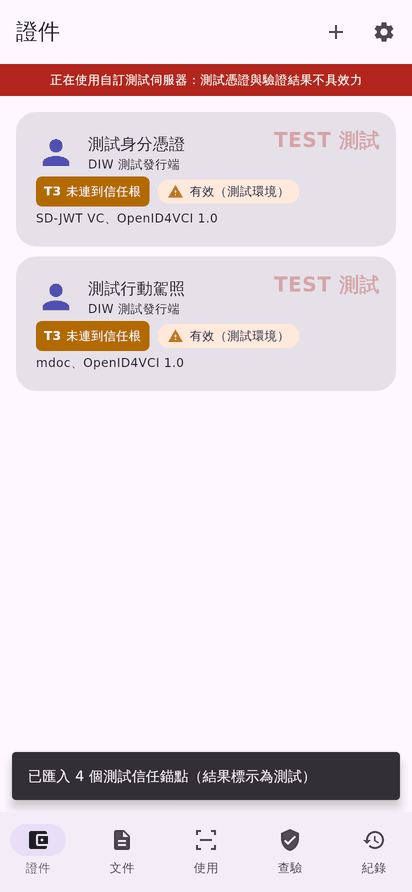

畫面下方有五個分頁，右上角的齒輪是「設定」。

| 分頁 | 用途 |
|---|---|
| **證件** | 所有數位證件在同一份清單，可以搜尋與依類別篩選。點證件可以看內容。 |
| **文件** | 保存 PDF、電子公文、OFD 等檔案，檢查簽章、加時戳、簽署，或做成可出示的證件。 |
| **使用** | 掃描 QR Code（出示、領卡都從這裡）、感應出示、年齡證明、臨櫃出示。 |
| **查驗** | 你當查驗方：請對方出示證件，在你的手機上檢查。 |
| **紀錄** | 領取、出示、查驗與簽署的紀錄。只記對象、時間與欄位名稱，不記欄位內容。 |

### 信任等級

發行端、查驗方與文件的簽署者都會標示信任等級：

| 等級 | 意思 |
|---|---|
| **T1** | 在官方信任清單上，並經過額外驗證。 |
| **T2** | 憑證連到可信任的根憑證（例如政府憑證、常見的公開憑證機構）。T1 與 T2 都視為高可信。 |
| **T3** | 可以驗證，但沒有連到任何信任根，無法確認對方是誰。測試用的來源也一律是 T3。 |
| **T4** | 驗證失敗。 |

判定結果同時用顏色、符號與文字表示：綠色是通過，橙色是需要留意，紅色是不應接受。信任等級低的操作不會被禁止，App 會列出風險，你勾選「我了解風險，並自行承擔後果」後才能繼續。

## 4. 加入證件


在「證件」分頁按「加入證件」（沒有證件時畫面中間就有這個按鈕），可以選擇：

- **從清單選擇**：政府皮夾卡片、自己製作的身分證卡與文件衍生憑證，或輸入發行端網址。
- **掃描 QR Code**：發行端網頁或櫃台提供的領卡 QR Code。
- **從圖片讀取 QR Code**：QR Code 的截圖或照片，例如在同一支手機上開啟的發行端網頁。

「使用」分頁的「讀取 QR Code」也能直接掃描領卡 QR Code：錢包會依內容自動判斷是領卡還是出示。

### 掃描發行端的 QR Code

1. 在發行端的網站或櫃台取得領卡 QR Code。
2. 掃描後，錢包顯示發行端的名稱、信任等級，以及它提供的證件。發行端提供多種證件時，勾選要加入的項目。
3. 發行端要求交易碼時，輸入對方另外提供給你的號碼。
4. 按「加入」。完成畫面顯示「已加入 N 張證件」，點證件可以查看內容。

在同一支 Android 手機的瀏覽器中點領卡連結，也會直接開啟本 App。

### 從清單選擇

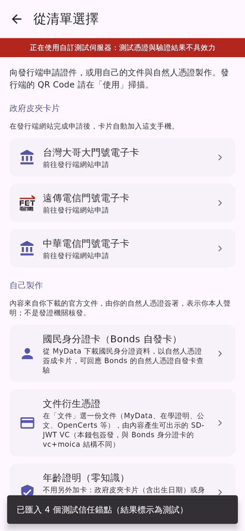

- **政府皮夾卡片**：列出數位憑證皮夾平台上可申請的卡片。點選後到發行端網站完成申請，卡片會自動加入。需要先啟用「數位憑證皮夾」的專門聲明。
- **自己製作**：用 MyData 下載的國民身分證資料製作 Bonds 相容的身分證卡（見[第 8 節](#國民身分證卡bonds-自發卡)），或把文件做成衍生憑證。這類卡片表示「你本人聲明」，不是發證機關核發。
- **其他發行端**：輸入支援 OpenID4VCI 的發行端網址，按「查詢」列出它提供的證件。

### 從瀏覽器或其他 App 存入

網頁或 App 以 Digital Credentials API 發卡時，Android 系統會列出本 App 作為存放位置，選它即可，流程與掃描 QR Code 相同。

### 查看與管理證件

點清單上的證件進入「證件內容」，可以看到：

- 卡面、發行端與它的信任等級、身分保證等級（IAL，發行端有提供時）；
- 證件資料（每個欄位）；
- 格式、規格、可用次數與金鑰保護方式；
- 「顯示技術細節」：簽章、憑證鏈、有效期間與狀態清單。

錢包會在背景定期查詢證件是否被撤銷或暫停，狀態改變時會通知並記入紀錄。不需要的證件可以在最下方「刪除證件」。

## 5. 出示證件

### 掃描查驗方的 QR Code

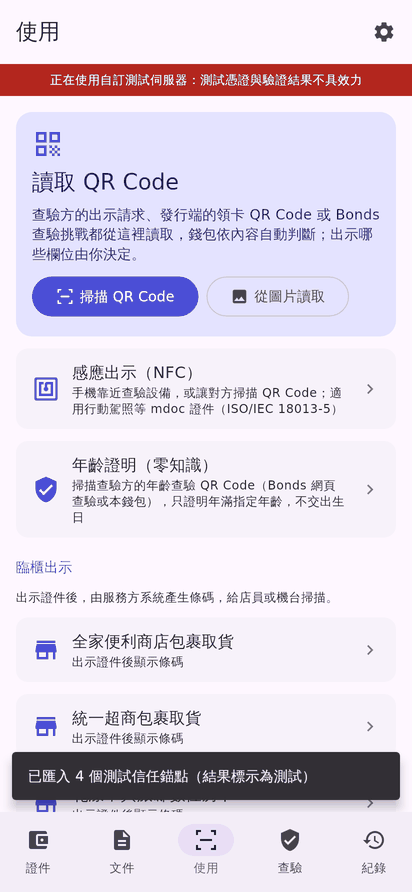

1. 到「使用」分頁，按「讀取 QR Code」掃描查驗方的 QR Code。QR Code 在截圖裡時，改用「從圖片讀取」。
2. 錢包先驗證請求，再顯示同意畫面。
3. 確認內容後按「同意分享」，或按「拒絕」。

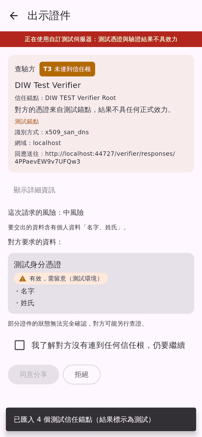

同意畫面依序說明：

- **查驗方**：名稱、識別方式（網域、DID 等）、信任等級，以及查驗方附上的註冊證明是否通過檢查。按「顯示詳細資訊」可以看更多。
- **提供資料的對象與用途**：查驗方說明的使用情境；數位憑證皮夾的請求還會附上知情同意書。
- **請求風險**：依要交出的欄位敏感程度與查驗方的信任等級，分為低、中、高風險，並寫出原因。
- **要交出的欄位**：只會送出畫面上列出的欄位。有多張證件符合時，可以按「更改憑證」換一張。

證件已被撤銷時，App 會再問一次「出示已撤銷的證件？」；判定為不應接受的證件不能出示。完成後畫面顯示「已出示」，紀錄分頁會留下這次出示的對象與欄位名稱。

在同一支手機上點網頁的出示連結，或網頁透過瀏覽器（Digital Credentials API）要求出示時，系統會直接開啟本 App 的同意畫面。只有 W3C 格式的證件（例如數位憑證皮夾卡片）不會出現在系統的選擇器中，請改用 QR Code 或連結出示。

### 感應出示（NFC）

適用行動駕照等 mdoc 格式的證件（ISO/IEC 18013-5）。

1. 在「使用」分頁按「感應出示（NFC）」。
2. 把手機背面貼近查驗設備的感應區，保持不動直到完成。
3. 對方要求的欄位會顯示在你的手機上，由你決定是否出示。

對方沒有感應區時，按「改用 QR Code」讓對方掃描，接著以藍牙傳送，所以要開啟藍牙。

### 臨櫃出示

「使用」分頁的「臨櫃出示」列出數位憑證皮夾的臨櫃服務。選擇服務並出示證件後，服務方的系統會產生條碼，給店員或機台掃描。需要先啟用「數位憑證皮夾」。

### 年齡證明（零知識）

只證明你年滿指定的年齡，不交出生日或其他欄位。可以使用含出生日期的數位憑證皮夾卡片，或 Bonds 身分證卡。

1. 在「使用」分頁按「年齡證明（零知識）」，掃描查驗方的年齡查驗 QR Code（Bonds 網頁查驗或本錢包產生的都可以）。
2. 選擇要用來證明的卡片，畫面會說明對方只會收到「出生日期不晚於某一天」的證明。
3. 按「產生並送出證明」。證明在你的手機上產生並先自我驗證，通過才送出。

證明可能需要數十秒。手機較慢時，錢包會顯示估計時間，讓你選擇仍在這台手機產生、改在電腦版或自己的主機產生，或不加零知識證明。查驗方在附近時，證明會以藍牙、同一個 Wi-Fi 或動態 QR Code 直接傳到對方手機，不經任何伺服器。

### Bonds 離線查驗

對方用 Bonds App 或本 App 顯示「Bonds 離線查驗挑戰」時，一樣在「使用」分頁掃描它，選擇證件與要揭露的欄位後出示。這是 Bonds 自有的格式，不屬於標準協定；Bonds 的藍牙傳輸沒有加密時，App 會先提醒你。

## 6. 文件：保存、檢查與時戳

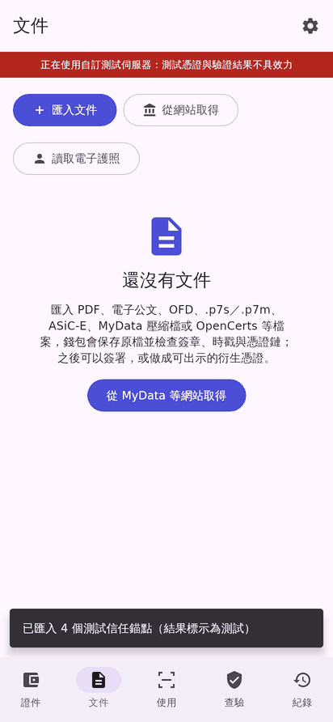

### 加入文件

「文件」分頁上方有三個入口：

- **匯入文件**：選擇裝置上的檔案，可一次選多份。支援 PDF、電子公文（.di、.si 與附件）、OFD、.p7s／.p7m、ASiC-E、XML、MyData 壓縮檔、OpenCerts、圖片與文字檔等。
- **從網站取得**：MyData、臺北市 MyDoc、教育部大專校院數位證書、戶政、地政、移民署、財政部稅務入口網等來源。手機版在 App 內開啟網站，下載的文件直接保存；需要行動自然人憑證登入時會轉到官方 App。電腦版在瀏覽器開啟，下載後回到「文件」用「匯入文件」保存。MyData 需要先啟用它的專門聲明。
- **讀取電子護照**：見[第 10 節](#10-電子護照與-zkpassport)。

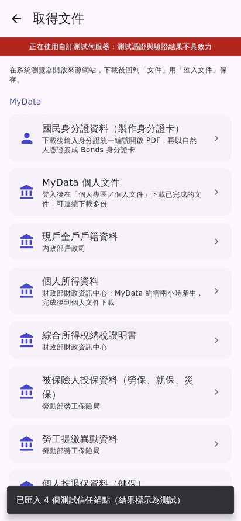

MyData 下載的壓縮檔會自動解壓、命名並解析。MyData 的 PDF 多半以身分證統一編號加密，在「設定 > 文件與簽章 > MyData 自動填入」保存統一編號與出生日期後，App 內登入 MyData 時會自動填入，下載的 PDF 也會自動開啟。資料只存在這支裝置。

相同內容的檔案會自動去重；同一類的分年度文件可以並存。清單可以切換「依保存時間」或「依項目」排列。

### 看懂檢查結果

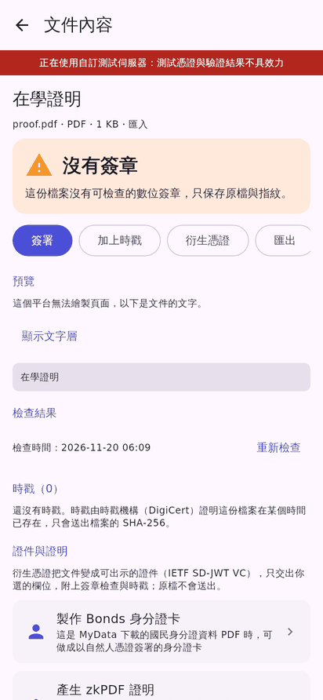

點文件進入「文件內容」。最上方是判定（「簽章有效」「簽章無效」「沒有簽章」等），下面是預覽與結構化內容（例如入出國日期證明書、在學證明、戶籍謄本、電子發票、公文「函」），再往下是每個簽章與時戳的檢查：

- **內容完整**：簽署後檔案有沒有被改過。
- **憑證鏈與信任等級**：簽署者是誰、憑證連到哪個信任根。按「審閱信任鏈與根憑證」可以一路看到根憑證。
- **涵蓋整份文件、簽署後的修改**：之後只加了簽章或時戳，還是有其他修改。
- **時戳與撤銷資訊**：簽署時間是否經時戳證明，以及憑證當時是否有效。

每次開啟文件都會依目前的時間與信任錨點重新判定，所以同一份文件的結果可能隨時間改變（例如憑證過期，或你加入了新的信任錨點）。

分離式簽章檔（.p7s、.asc、.sig）需要原檔才能檢查：在「其他動作」按「選擇被簽署的檔案」。

### 加上時戳

時戳證明這份檔案在某個時間點已經存在。在文件內容按「加上時戳」，錢包只會把檔案的 SHA-256 送到時戳機構，不會送出檔案本身。時戳機構可以在「設定 > 文件與簽章」選擇，也可以設定成保存文件時自動加時戳。

### 匯出、分享與刪除

- **匯出**：另存原檔。
- **匯出文件與證據**：壓縮檔內含原檔、時戳（.tsr）、憑證、OCSP 與 CRL，可以交給其他工具查驗。
- **分享**：Android 可以直接交給其他 App。
- **刪除文件**：檔案與它的時戳會從這支裝置刪除，無法復原；已產生的衍生憑證會保留在「證件」。

### 電子公文

匯入含簽核檔（.si）的壓縮檔時，錢包會依簽核檔建立「公文容器」，把公文、附件與簽核檔放在一起，其他無法對應的檔案列出依據讓你確認是否放入。公文容器依簽核點分兩層，顯示每個檔案是否齊全、與簽核時是否相同，以及簽核點的簽章。整個容器可以一次取得撤銷資訊、匯出或分享。

「公文交換（收發）」需要機關的公文電子交換帳號與憑證，個人錢包無法使用，畫面上顯示為停用。

## 7. 簽署文件

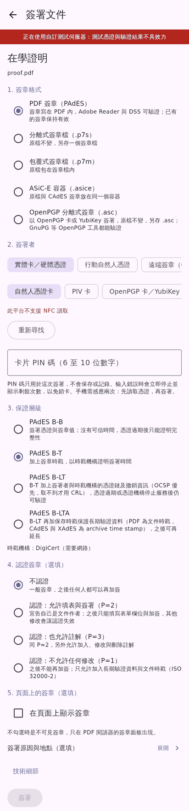

在文件內容按「簽署」，依序選擇：

1. **簽章格式**：依檔案類型列出可用的格式。
   - PDF 簽章（PAdES）：簽章寫在 PDF 內，Adobe Reader 可驗證。
   - 分離式簽章檔（.p7s）、包覆式簽章檔（.p7m）、ASiC-E 容器：適用任何檔案。
   - XML 簽章（XAdES）、OFD 數位簽章或電子印章、OpenPGP 分離式簽章（.asc）。
   - 電子公文簽核（線上簽核 .si）：在簽核檔加一個簽核點，公文與附件本身不改動。
   - C2PA 內容憑證（CAWG 身分）：記錄誰製作或簽署這個檔案、如何製作，供 C2PA 檢視與驗證工具讀取。JPEG、PNG、WebP 會另存一份內嵌 manifest 的副本；其他檔案無法內嵌，另存為「檔名.c2pa」，要和原檔放在一起才能檢查。選項見下方「C2PA 內容憑證的選項」。
2. **簽署者**：用哪一把金鑰簽。
   - 實體卡／硬體憑證：自然人憑證卡、PIV 卡、OpenPGP 卡（含 YubiKey）。手機以 NFC 感應或接 USB 讀卡機，電腦接 PC/SC 讀卡機。
   - 憑證檔（PKCS#12）、系統金鑰；電腦版另可使用 PKCS#11 程式庫。
   - 遠端簽章（CSC）：內建 EUDI 測試服務，也可以自行加入服務。
   - 行動自然人憑證：需要內政部核發的服務提供者（SP）帳號，發布的版本沒有內建，一般使用者目前無法使用。
   - 錢包自有金鑰：自簽的憑證，只能證明檔案沒有被改過，機關不會承認。
3. **保證層級**（PAdES、CAdES、XAdES、ASiC-E）：B-B（基本）、B-T（加簽章時戳）、B-LT（再加憑證鏈與撤銷資訊）、B-LTA（再加保存時戳）。要長期保存或給機關的文件建議選 B-LT 以上。取不到撤銷資訊時，App 會說明實際能達到的層級。C2PA 沒有保證層級，只有「加上時戳」可勾選。
4. **認證簽章（PDF，選填）**：宣告之後不允許變更、只允許填表，或允許填表與註解。只能用在第一個簽章。
5. **頁面上的簽章（PDF，選填）**：勾選「在頁面上顯示簽章」後選擇頁面與位置，可以加入簽名圖片。不勾選時是不可見簽章，只在閱讀器的簽章面板出現。

也可以填寫簽署原因與地點。按「簽署」後，簽出的檔案會另存為新文件，原檔保留，畫面顯示實際達到的保證層級。

### C2PA 內容憑證的選項

- **內容的來源**：「簽署現有的檔案」只為檔案背書，不說明由誰製作；「內容由我製作」要再選數位來源類型（例如相機拍攝、生成式 AI）。宣告生成式 AI 會讓檢視者知道內容由訓練過的模型產生。檔案原有的內容憑證會保留，成為新 manifest 的父成分。
- **CAWG 身分**：勾選「加入以所選金鑰簽署的身分宣告」後選擇角色（創作者、編輯等）。勾選「由錢包金鑰簽署聲明」時，錢包金鑰簽 C2PA 聲明，所選的卡片或金鑰只簽身分宣告，卡片只需使用一次。
- **AI 訓練與資料探勘**：不聲明、允許或不允許。
- **互通選項（非標準）**：「c2pa-rs 的 signer_payload 順序」。預設照規格簽署，但以 c2pa-rs 建構的檢查工具（例如 contentcredentials.org）目前會把預設的身分宣告判為簽章不符；要給這類工具檢查時再勾選。
- 其他驗證工具會檢查憑證的金鑰用途：自然人憑證卡多半沒有 CAWG 要求的用途，簽出的身分在錢包顯示為「身分已驗證，但沒有連到信任根」；錢包金鑰的自簽憑證可驗證，但沒有驗證工具會信任。

檢查含 C2PA 的圖片時，文件內容會列出「CAWG 身分宣告」與「AI 生成與浮水印」。AI 的部分只讀檔案裡的宣告（「宣告、未偵測浮水印」），沒有宣告不代表不是 AI 生成。檔案提到 SynthID 或宣告由 Google 的生成式 AI 製作時，可以按「到 Google SynthID 網站查驗」：網站需要登入、每天次數有限，要先以「匯出」另存檔案再自行上傳，錢包本身不傳送任何資料。

已簽署的 PDF 可以用「延長保存」補上長期驗證資料與文件時戳。在「設定 > 文件與簽章 > 簽署金鑰與憑證」可以先讀取卡片或金鑰，查看它的憑證。

## 8. 把文件做成可出示的證件

### 衍生憑證

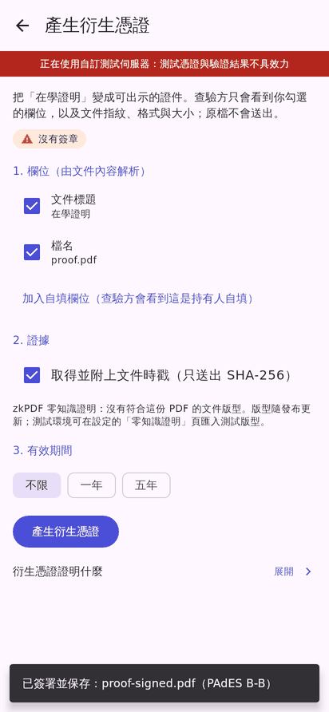

衍生憑證把一份文件變成可出示的證件。查驗方只會看到你勾選的欄位，以及文件的指紋、格式與大小，原檔不會送出。

1. 在文件內容按「衍生憑證」。
2. **欄位**：錢包從文件內容解析出欄位，勾選要放進證件的項目。也可以加入自填欄位，查驗方會看到那是持有人自填。
3. **證據**：附上文件簽章檢查的結果、已保存的時戳，或當場取得新的時戳。
4. **有效期間**：一年、五年或不限。
5. 按「產生衍生憑證」，證件會出現在「證件」分頁。

衍生憑證由這支錢包簽發，信任等級為 T3：它證明你在何時、以哪些證據保存了這份文件，不代表原發文機關另行背書。

有符合的文件版型時，還可以「產生 zkPDF 證明」：以零知識證明說明欄位確實出自 PDF 內的簽章，不必交出整份文件。在手機上產生很慢，建議在電腦版產生：手機建立請求後，在電腦版錢包的「零知識證明」設定頁開啟請求檔產生證明，再把 .zkpdf 檔匯回手機。

### 網站查驗證明（zkTLS）

部分文件可以到官方查詢頁即時查詢，把結果存成證據（目前有學信網學籍報告、移民署入出國日期證明書）。在文件內容按「產生網站查驗證明（zkTLS）」，選擇透過查驗主機產生 zkTLS 證明，或只用這支手機查詢並保存為本機紀錄（裝置證明，信任程度較低）。

### 國民身分證卡（Bonds 自發卡）

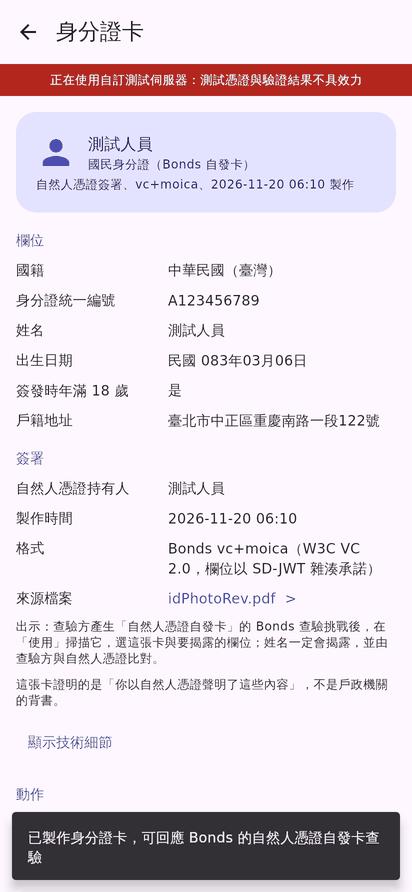

把 MyData 下載的「國民身分證資料」PDF 做成 Bonds 相容的身分證卡，欄位由你的自然人憑證簽署，查驗方可以只看你選的欄位（例如只看是否年滿 18 歲）。

1. 到「文件 > 從網站取得」，選「國民身分證資料（製作身分證卡）」並下載。
2. 開啟這份 PDF，按「製作 Bonds 身分證卡」，輸入身分證統一編號開啟檔案（編號只用來開啟，不會保存）。
3. 確認欄位後按「以自然人憑證簽署」，以 NFC 或讀卡機讀取自然人憑證卡並輸入 PIN；或點「改用行動自然人憑證」，經你的服務端（需開啟 `twfido`）或其他服務提供者帳號簽署，並在行動自然人憑證 App 確認兩次（第一次取得憑證，第二次簽署）。

自然人憑證上的姓名必須與身分證資料相同。這張卡證明的是「你以自然人憑證聲明了這些內容」，不是戶政機關的背書。出示時，查驗方產生「自然人憑證自發卡」的 Bonds 查驗挑戰，你在「使用」分頁掃描它即可。

## 9. 查驗他人的證件

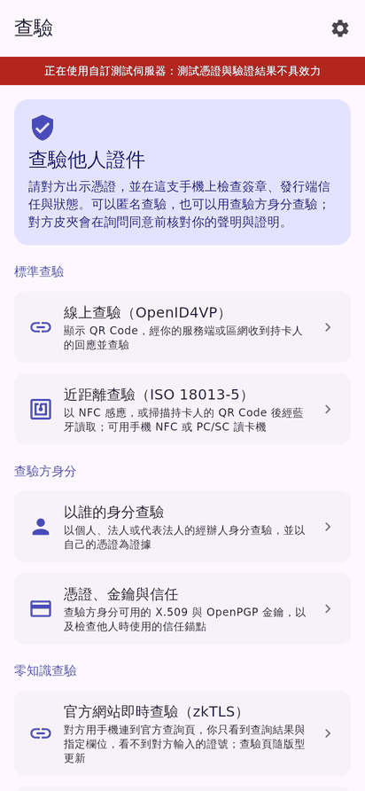

「查驗」分頁讓你當查驗方：請對方出示證件，在你的手機上檢查簽章、發行端信任與狀態。

### 線上查驗（OpenID4VP）

1. 按「線上查驗（OpenID4VP）」，選擇要求的證件與欄位、接受的可信程度，以及回應的傳送方式。
2. 回應可以「經服務端轉送」（需要在「設定」的「零知識證明」頁設定正式服務端），或在兩支手機連同一個 Wi-Fi 或熱點時「區網直連」。
3. 請對方用錢包掃描畫面上的 QR Code。收到回應後，錢包顯示是否「符合查驗政策」與對方揭露的資料。

### 近距離查驗（ISO 18013-5）

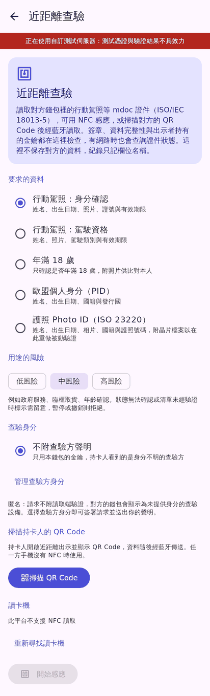

適用行動駕照、歐盟個人身分（PID）、護照 Photo ID 等 mdoc 證件。選擇要求的內容（例如「行動駕照：身分確認」或「年滿 18 歲」），按「開始感應」後讓對方的手機靠近你的手機背面，或掃描對方的 QR Code 後經藍牙讀取。電腦版可用 PC/SC 非接觸式讀卡機。

### 以誰的身分查驗

預設是匿名查驗：對方的錢包會顯示為「身分不明的查驗方」。在「以誰的身分查驗」可以建立查驗方身分（個人、法人，或代表法人的經辦人），用你錢包裡的證件、X.509 憑證或 OpenPGP 卡證明身分。對方的錢包在詢問同意前會核對你的聲明與證明，所以使用查驗方身分時，對方比較容易信任你的請求。

### 官方網站即時查驗（zkTLS）

1. 按「官方網站即時查驗（zkTLS）」，選擇查驗頁（例如移民署入出國日期證明書）與要揭露的欄位，按「產生查驗 QR Code」。
2. 對方用本錢包掃描後，他的手機會直接連到官方查詢頁查詢，你只看到查詢結果與指定欄位，看不到對方輸入的證號。
3. 兩支手機要連同一個 Wi-Fi，或在設定中填入有提供中繼的查驗主機。請求 10 分鐘內有效。

### 以 zkPassport 查驗護照

見[第 10 節](#查驗他人的護照)。

### Bonds 相容查驗

展開「Bonds 相容查驗（非標準）」可以產生「Bonds 離線查驗挑戰」與年齡查驗，給使用 Bonds App 或數位憑證皮夾卡片的人出示。選擇接受的證件、填寫查驗用途與風險後按「產生查驗挑戰」，對方掃描後在你的手機上檢查。

## 10. 電子護照與 zkPassport

### 讀取電子護照

電子護照的封面有晶片標誌。讀取需要手機有 NFC。

1. 到「文件」分頁按「讀取電子護照」。
2. 選擇讀取方式：輸入資料頁的證號、出生日期與效期，或輸入卡面的 6 位數卡片存取號碼（CAN，只有部分新式證件有）。Android 可以按「用相機掃描機讀區」自動帶入，機讀區只在本機辨識，不保存影像。
3. 按「讀取晶片」，把護照資料頁貼在手機背面保持不動，約需數秒。

讀出的資料會做被動驗證（確認是發照國簽發、沒有被改過）並存成文件，讀取時不會連網。之後可以從這份文件產生衍生憑證，或「產生 Photo ID」（標準 mdoc，可以出示給要求護照資料的查驗方）。

### 回應 zkPassport 請求

需要先啟用 zkPassport 的專門聲明，並已讀取電子護照。

1. 網站或 App 顯示 zkPassport 的 QR Code 時，在「使用」分頁掃描它；在同一支手機上則直接點網頁的開啟按鈕。
2. 畫面列出請求方、用途，以及證明將確立的事項（例如年齡條件、國籍是否屬於某些國家）。標示「請求所述，未經驗證」的項目是對方自己說的。
3. 選擇用來證明的護照，以及在哪裡產生證明：這台裝置、自架主機，或同一個內網的臨時證明器。
4. 按「產生並送出」。產生可能需要數分鐘，送出前請保持 App 開啟。

請求要求人臉比對時，Android 版會用相機把你的臉與護照晶片的照片比對，比對在本機進行，影像與分數不保存也不傳送。只接受 zkPassport 官方 App 人臉比對的請求，本錢包無法回應；電腦版沒有人臉比對。

### 查驗他人的護照

在「查驗」分頁按「以 zkPassport 查驗護照」，設定要確認的條件（最低年齡、國籍、發證國等）與你的網域、服務名稱，請對方用 zkPassport App 掃描。零知識證明在你的手機上依 zkPassport 註冊表驗證，你只會看到證明承諾的值。

### 兩支本錢包之間與沒有網路時

- 對方也用本錢包時，除了 zkPassport 的傳送服務，回應也可經你設定的服務端轉送，或在附近經同一個 Wi-Fi／熱點、藍牙（Android）直接送到你的手機。設定的 zkPassport「離線查驗」可關閉「接受附近本錢包的回應」。
- 經區域網路或藍牙收到的請求沒有網站來源可以比對，回應前會再確認一次，只回應你面前的查驗方。
- 要在沒有網路時查驗或回應，先在有網路時按設定的「下載離線查驗資料」：查驗方的手機保存註冊表狀態與電路清單，回應方的手機為每本已保存的護照下載需要的電路。離線的結果會註明註冊表狀態的日期，並標示為「需留意」。兩支手機下載資料的日期相差太久時可能無法離線查驗，需要其中一方連上網路。

## 11. 紀錄

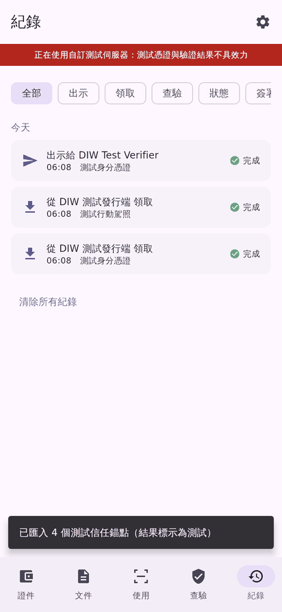

「紀錄」分頁依日期列出每次領取、出示、拒絕、查驗、簽署與狀態變更，可以依類型篩選。點一筆紀錄可以看對方的信任等級與涉及的欄位名稱。紀錄不保存欄位內容；「清除所有紀錄」只刪除紀錄，證件本身不受影響。

## 12. 設定

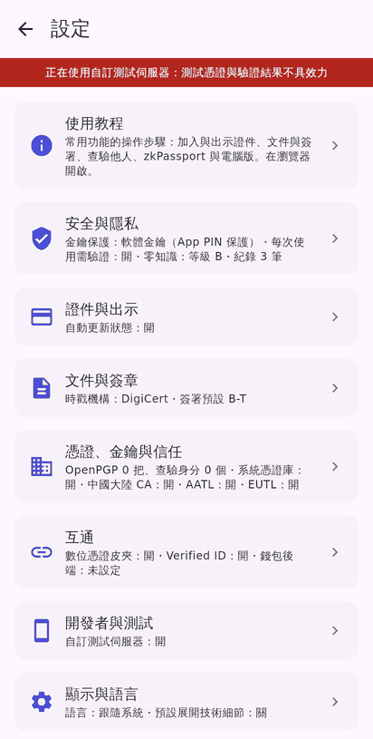

右上角齒輪進入設定。第一列是這份「使用教程」，下面分成九組，每一組在清單上直接顯示目前的設定：

| 組別 | 主要內容 |
|---|---|
| 安全與隱私 | 金鑰保護方式、每次使用前是否要求生物辨識或裝置 PIN、零知識證明（裝置等級、電路下載、正式服務端與證明器）、清除紀錄 |
| 證件與出示 | 自動更新證件狀態、立即更新、瀏覽器與 App 出示與收卡的系統註冊 |
| 文件與簽章 | 時戳機構、保存時自動加時戳、撤銷資訊、預設保證層級、簽署金鑰與憑證、MyData 自動填入 |
| 憑證、金鑰與信任 | 信任等級說明、自訂信任、信任錨點、數位憑證皮夾信任清單、要不要信任系統憑證庫、中國大陸 CA、Adobe AATL、歐盟 EUTL |
| 互通 | 數位憑證皮夾與 Verified ID 的啟用狀態、近距離出示的 NFC 交握方式、正式發證端要求的錢包身分 |
| 開發者與測試 | 自訂測試伺服器與測試錨點。一般使用者不需要更動 |
| 顯示與語言 | 介面語言（繁體中文、英文或跟隨系統）、預設展開技術細節 |
| 法律聲明與同意 | 重新閱讀用戶協議、隱私權政策與專門聲明，啟用或撤回各項服務 |
| 關於 | 版本、授權、第三方元件與原始碼 |

加入或移除信任錨點等會影響信任判定的操作，需要再次驗證才會生效。

## 13. 電腦版

電腦版（Windows、Linux、macOS）與手機版共用大部分功能，差別如下：

- **開啟**：每次開啟要輸入 App PIN。資料以 App PIN 加密，存在 Windows 的 `%APPDATA%\DIW-MY-WALLET`、Linux 的 `~/.local/share/diw-my-wallet`、macOS 的 `~/Library/Application Support/DIW-MY-WALLET`。刪除這個資料夾會清除電腦版的所有資料。同一時間只能開一個電腦版（一般版與原生版共用這個資料夾）；再開一個時會提示「已經在執行」並結束。看不到視窗卻出現這個提示時，從工作管理員（Linux 用系統監視器）結束殘留的 DIW MY WALLET 再開啟。
- **QR Code**：沒有相機時，從截圖或圖片讀取 QR Code，或在「使用」分頁最下方「貼上連結」貼上領卡連結或出示請求。電腦版不會自動接手瀏覽器中的連結。
- **感應**：可以接 PC/SC 非接觸式讀卡機讀取對方的 mdoc（Linux 需安裝並啟動 `pcscd`），也可以讀取自然人憑證卡或 PIV 卡來簽署；電腦不能以 NFC 出示證件。
- **取件網站**：在系統瀏覽器開啟，下載後回到「文件」用「匯入文件」保存。
- **分享**：沒有「分享」，請用「匯出」另存檔案。
- **零知識證明**：電腦通常比手機快，適合產生 zkPDF 證明，或在手機選擇「改用電腦版回應」。Windows 版沒有 mdoc 零知識出示（Longfellow）；zkPassport 的人臉比對只在 Android 版。

## 14. 常見問題

**掃描後出現「無法完成」。**
畫面會寫出原因。常見的是請求已過期（請對方重新產生 QR Code）、這支手機沒有對方要的證件，或相關服務的專門聲明尚未啟用。

**對方的信任等級是 T3，可以出示嗎？**
可以，但代表錢包無法確認對方是誰。只有在你確定對方身分、而且要交出的資料不敏感時才繼續。App 會列出風險，勾選承擔後才能出示。

**數位憑證皮夾的新版卡片領不到。**
新版夥伴卡平台是否接受本 App 還沒有驗收，平台可能拒絕。本 App 不是官方皮夾，見[專案現況](../STATUS.md#4-未完成與待決定)。

**MyData 的 PDF 打不開。**
MyData 文件以身分證統一編號加密。在開啟時輸入編號，或到「設定 > 文件與簽章 > MyData 自動填入」保存後自動開啟。

**行動自然人憑證不能用。**
行動自然人憑證需要內政部核發的服務提供者（SP）帳號，發布的版本沒有內建，目前請改用實體自然人憑證卡。

**零知識證明很慢，或顯示裝置等級不足。**
手機記憶體或效能不足時，App 會讓你選擇改在電腦版或自己的主機產生，或不加零知識證明。zkPDF 在手機上可能要十分鐘以上，建議用電腦版。

**換手機或重新安裝後證件不見了。**
App 不使用雲端備份，證件的金鑰只存在原本的裝置，需要重新向發行端領取。文件可以先用「匯出」或「匯出文件與證據」另存，再到新裝置匯入。

**看到紅色橫幅或「測試」字樣。**
這代表結果來自測試環境（測試錨點、測試發證端或測試伺服器），不具效力。一般使用者不需要開啟「設定 > 開發者與測試」的選項。

**要回報問題。**
請到 [GitHub Issues](https://github.com/mctea01/my-Bonds-fork-android/issues) 描述操作步驟與畫面上的訊息。不要附上含個人資料的截圖或文件。
