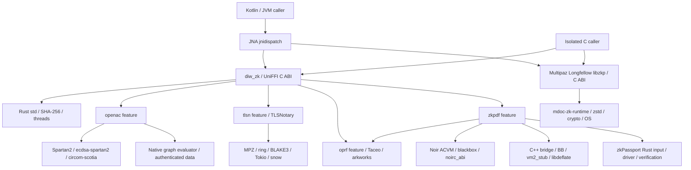

# R00：用途分類與依賴圖

基準與來源雜湊見 [baseline.json](evidence/baseline.json)。清冊為 [native-dependency-inventory.csv](native-dependency-inventory.csv)；原生包裝器補充為 [other-native-dependencies.csv](other-native-dependencies.csv)。

圖中的 C caller 是研究 PoC，沒有接入 App。DIW 的 `default=[]`，其餘四個 feature 是編譯選項；符號存在不代表後端已啟用。Longfellow 另由 Maven 套件提供，不受這些 feature 控制。`zkpassport-verify` 單獨的承諾／結構檢查並非完整 proof verification，錢包的完整 callback 仍進入 BB。

| 分類 | 元件與界線 |
|---|---|
| 執行期必要（現有 JVM App） | Skiko/Skia、SQLite JDBC 的 JNI、JNA native dispatch、JDK native components；實際依功能及平台載入 |
| 條件式功能 | DIW ZK features、Longfellow、CameraX JNI、智慧卡及 PKCS#11 模組；OpenAC graph/r1cs/keys 與 CRS 為資料，不是新增可執行碼 |
| 僅建置期 | Rust/C/C++ compiler、CMake、Ninja、NDK、protoc、libclang、UniFFI bindgen、Circom/build-circuit；不能列成裝置必備 runtime |
| 測試／研究 | bb.js 2.1.9、Circom WASM witness oracle；不等於 BB6 App runtime |
| 平台系統 | libc/CRT、C++ runtime、thread、socket、entropy、PC/SC、vendor PKCS#11、圖形／字型系統 |
| 外部 host 執行契約 | Android DC API matcher WASM；WebView／瀏覽器 JavaScript；保留其必要用途，不推導成 PC 密碼學引擎需求 |

Cargo 鎖檔共有 581 個套件記錄，完整來源與 checksum 見 [cargo-lock-packages.csv](evidence/cargo-lock-packages.csv)。這是 workspace、optional、dev 與多 target 的聯集，不能直接算成 581 個 runtime dependencies。各後端的來源分析見 [rust-backends.md](rust-backends.md)。本輪 runtime 與 OPRF 的實際建置使用原鎖檔，沒有變更套件解析結果。

Gradle 離線依賴報告見 [desktop](evidence/gradle-desktop-dependencies.txt) 與 [Android](evidence/gradle-android-dependencies.txt)。報告雖 exit 0，內含 `FAILED` 節點，因此不是完整解析成功。後續 [desktop-online](evidence/gradle-desktop-online.txt) 與 [Android-online](evidence/gradle-android-online.txt) 均成功且未出現 `FAILED` 節點；這驗證所查 configuration 的依賴圖，不代表全部 artifacts 已下載／載入。快取掃描的 archive/entry SHA-256 在 [cached-native-entries.csv](evidence/cached-native-entries.csv)；另實際下載 JNA 5.19.1、Longfellow 0.102.0 JAR/AAR，清單見 [maven-native-entries.csv](evidence/maven-native-entries.csv)。這些是實際檔案證據，並非所有候選 target 的發行保證。

尚待補齊的盤點邊界：每個 target 完整解析後的 Gradle runtime artifacts、最終 APK／桌面包、JDK 本身原生組件、各庫的所有傳遞授權與 CPU 指令。這些缺口列入後續清單，不能以本輪來源盤點替代發行稽核。
