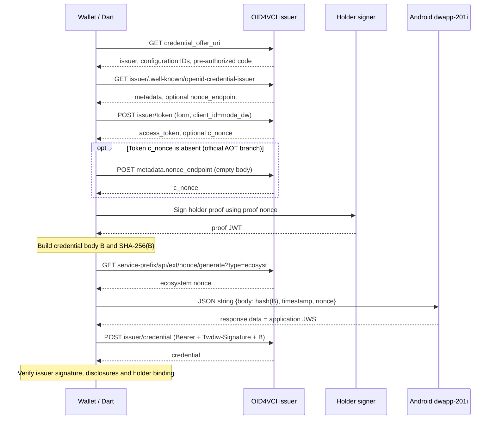

# TWDIW 1.0.14：簽章、公私鑰來源與 OID4VCI 領卡流程

整理日期：2026-11-02。範圍為目前已分析、核對官方 APK 簽章的 Android **1.0.14**，不代表未取得的後續版本。本文件彙整 Dart AOT、主 DEX／解封 stage-b、native helper 模擬與既有伺服器量測；不是由完整實機封包重建的逐包紀錄。

## 1. 三種金鑰與用途

| 金鑰 | 私鑰來源 | 公鑰來源／識別 | 用途 |
|---|---|---|---|
| Holder 金鑰 | 裝置端產生的 P-256 EC 金鑰；Android `uiW5atgU` 路徑使用 Keystore，先要求 StrongBox，不可用時有不要求 StrongBox 的重試 | 該 KeyPair 的公鑰轉 JWK／did:key；proof Header 的 `kid` 是 holder DID | 簽 OID4VCI `proofs.jwt`，證明持有收卡金鑰；後續出示也有 holder 簽章 |
| `dwapp-201i` 應用簽章金鑰 | SDK `N3Kf59pP` 的 getter 讀 APK `assets/dwapp201i_private.txt`，經受保護串流處理、去空白／Base64、`PKCS8EncodedKeySpec`、`KeyFactory("EC").generatePrivate` 匯入 | `assets/dwapp201i_public.txt` 經兩層 reader 得正規化 Base64 SPKI 文字；該文字的 SHA-256 小寫 hex 填 `payload.keyId` | 簽 HTTP `Twdiw-Signature`，綁定應用資訊、credential request body 與 ecosystem nonce |
| 發行者金鑰 | 發行者／其後端持有；不是手機上的上述兩把私鑰 | TWDIW 已確認的憑證可由 `iss` DID 解析公鑰，再確認發行者信任關係 | 簽發收到的 credential；錢包負責驗證 |

Keystore 的 `setIsStrongBoxBacked(false)` 不等於已證明落在 TEE；實際硬體安全等級仍需裝置資訊。`android-keystore://` 也會出現在 Tink 保護路徑，不能僅靠這個字串把金鑰用途對到 `dwapp-201i`。

本環境已核對應用私鑰的**讀取與簽章呼叫鏈**，但沒有解出／輸出／重用其私鑰，也沒有執行該 getter。因此未獨立驗證資產公私鑰配對、所有例外分支，或不同版本／安裝之間的共用與輪替政策。公鑰 reader 已離線重現並解析為 P-256；私鑰資產不能僅憑檔名當成明文 PEM。

## 2. `dwapp-201i` 的簽章步驟

### Dart：準備已包含 holder proof 的 credential request

先建立完整請求物件，例如：

```json
{"credential_identifier":"<configuration-id>","proofs":{"jwt":["<holder-proof-jws>"]}}
```

令 `B = UTF8(jsonEncode(requestBody))`，計算：

```text
bodyHash = lowercase_hex(SHA-256(B))
timestamp = decimal_string(current_unix_time_in_milliseconds)
```

簽署後送出的 body 必須與 `B` 相同。重排成員、補換行、換一份 holder proof 都會改變 bodyHash；不是只雜湊 proof 或 pre-authorized code。

再由下節的 ecosystem nonce 取得 `ecosystemNonce`，傳入：

```text
channel = did_sdk_channel
method  = dwapp-201i
arguments = JSON 字串，不是 Map 物件
```

```json
{"body":"<bodyHash>","timestamp":"<Unix-milliseconds>","nonce":"<ecosystemNonce>"}
```

這裡的 `body` 已是雜湊字串。原生端將它填入 `bodyHash`，不是再對這段 hex 計算一次請求雜湊。

### Android SDK：補欄位、載入應用私鑰並簽 JWS

成功路徑 Header 的精確 JSON：

```json
{"alg":"ES256","typ":"JWT"}
```

七欄 Payload 的 DTO adapter 明確依下列順序輸出；全部是字串：

```json
{
  "appHash":"tw.gov.moda.diw",
  "appPlatform":"Android",
  "appVersion":"1.0.14",
  "bodyHash":"<Dart 傳入的 body>",
  "keyId":"dfbbc7e88f69844fe449aca4f02ce1d719ddaaad9e3fd9dc25f1934869bc5a82",
  "nonce":"<ecosystemNonce>",
  "timestamp":"<Unix-milliseconds>"
}
```

- `appHash`：`Context.getPackageName()` 的原字串，沒有做 SHA-256。上述值是官方 package；自有應用身分應填自己的值。
- `appPlatform`：已由 unidbg 執行真實 native helper 確認為 `Android`，不是僅按長度猜測。
- `appVersion`：本次 1.0.14 handler 的字面值。
- `keyId`：公鑰 asset 通過 `VVcmSog7` 及 `ua7zwMYm` 等兩層 reader 後，讀 UTF-8、去空白，對所得 **Base64 SPKI 文字的 UTF-8 bytes** 做 SHA-256 小寫 hex。上列是本版本靜態還原值，尚無實機 JWS 對照。它不是密文檔案雜湊、SPKI DER bytes 雜湊或 holder DID。

令 `b64u` 為 URL-safe、無換行、無 padding 的 Base64：

```text
H = b64u(UTF8(compact_json(header)))
P = b64u(UTF8(compact_json(payload)))
M = ASCII(H + "." + P)
DER = SHA256withECDSA(application_private_key, M)
raw = I2OSP(R, 32) || I2OSP(S, 32)
JWS = H + "." + P + "." + b64u(raw)
```

`SHA256withECDSA` 已含 SHA-256 步驟；直接交給它 `M`，不要先把 `M` 雜湊後又以相同 API 重複雜湊。DER 轉 raw 使用 `r3OTB7M` helper；Base64 helper `lJGlmuQP` 使用 Android flag 11。Header DTO 只有 alg／typ，沒有 header.kid；keyId 位於 Payload。

Dart 的 `Utils.callDwapp201i` 解析原生回應，成功 code 為 0 時取 `data` 中的 JWS 字串。`HttpService.getVC` 將該字串放入 HTTP Header `Twdiw-Signature`。

## 3. 新版領卡流程

以下是已追蹤的 pre-authorized code 成功路徑。圖中的請求 URL 以本次官方方言為準，沒有額外加入推測的手機註冊 POST。



### 0. 入口與 offer

已見官方入口包含 `modadigitalwallet://credential_offer?credential_offer_uri=...` 與 frontend 的 `/api/moda/vcqrcode` 中轉連結。靜態申請卡片 QR `/api/moda/qrcode` 則可能先經 `/api/moda/dwapp/serviceUrl/{uid}` 取得服務入口，完成發行者身分驗證後才交回 offer；不能把所有 QR 當成同一個 API。

本次已明確定位 `Twdiw-Signature` 的位置是 credential POST。沒有足夠證據將每個 QR 解析、offer GET 或 token POST 一律加上同一標頭；先前附件把簽章泛稱為 QR 前置通道的敘述不應直接當成呼叫順序。

`GET credential_offer_uri` 後取得：

- `credential_issuer`：例 `https://moda.wallet.gov.tw/oid4vci/api/issuer/<id>/`。
- `credential_configuration_ids`：本次官方路徑取第一個 ID。
- `grants["urn:ietf:params:oauth:grant-type:pre-authorized_code"].pre-authorized_code`。

既有 demo 量測中 offer 曾是一次性，不能為了預覽而重複消耗真正領卡連結。

### 1. Discovery 與 Token

官方方言會保留 issuer 路徑及尾斜線，附加 `.well-known/openid-credential-issuer` 取得 metadata；不是把 `.well-known` 移到網域根目錄。

本次 AOT 的 token URL 是在 issuer base 解析相對路徑 `token`，以 `application/x-www-form-urlencoded` POST。下列是表單成員，實際 wire 須做 form encoding：

```text
grant_type = urn:ietf:params:oauth:grant-type:pre-authorized_code
client_id = moda_dw
pre-authorized_code = <offer code>
authorization_details = [{"type":"openid_credential","credential_configuration_id":"<first configuration ID>"}]
tx_code = <transaction code; empty string when none>
```

`getAccessToken` 會傳 tx_code 參數，未使用交易碼的路徑填空字串；不能把空字串描述成所有發行者都不要求交易碼。`client_id=moda_dw` 是已觀察到的相容性常數，並不單獨證明應用身分已被鑑別。

成功取得 `access_token` 及可能的 `c_nonce`。

### 2. Holder proof JWT

**官方 1.0.14 AOT 行為**：token 的 `c_nonce` 非 null 時使用它；缺少時讀 metadata `nonce_endpoint`，`HttpService.getCNonce` 對該 URL 發送 POST，無 body，再讀回應的 `c_nonce`。缺少可用 proof nonce 時不能改拿 ecosystem nonce 代替。

**另有伺服器實測**：repo 的 2026-10-16 紀錄顯示 moda 新端點要求 nonce endpoint 的值，部分情況 token nonce 被拒；現行本錢包因此優先取 endpoint。這是伺服器量測／本錢包相容策略，不能反寫成官方 AOT 在任何情況都優先取 endpoint。沒有 nonce endpoint 的舊端點則有使用 token nonce 的紀錄。

Header 與 Payload 示意：

```json
{"alg":"ES256","typ":"openid4vci-proof+jwt","kid":"<holder did:key>"}
```

```json
{"iss":"moda_dw","aud":"<credential_issuer, including trailing slash>","iat":1793664000,"nonce":"<proof nonce>"}
```

`iat` 是 Unix **秒數字**，和應用 JWS 的 timestamp **毫秒字串**不同。以 holder 私鑰簽 ES256，簽章同樣採 JOSE 64-byte R||S。

TWDIW 的已見 DID 使用 `jwk_jcs-pub` multicodec `0xEB51`（varint bytes `d1 d6 03`）及 JWK 內容，整體為 `did:key:z` 加 Base58btc。proof 的 kid 使用不帶 fragment 的 holder DID。產生 DID 與後續解析應保持公鑰一致；不應只因名稱含 jcs 就假設每個官方版本都已做嚴格 JCS 排序。

既有實測：只放 jwk、不放 kid 曾遭拒；kid 加 jwk 曾通過 proof。這不代表所有 jwk 組合都無效，也不代表此組合一定能通過後續應用簽章驗證。

### 3. 組 credential body，取 ecosystem nonce，簽應用 JWS

本次官方 AOT 把 offer 的第一個 configuration ID 填入 `credential_identifier`，並加入 holder proof：

```json
{"credential_identifier":"<first configuration ID>","proofs":{"jwt":["<holder-proof-jws>"]}}
```

這是已見官方方言的行為；不可與標準流程中 token 授權結果核發的 credential identifier 混為同一種來源。

從 `applyVCUrl`（內部 issuer base）取 `/api/` 前段，再附加 `api/ext/nonce/generate?type=ecosyst`。例如：

```text
issuer: https://moda.wallet.gov.tw/oid4vci/api/issuer/<id>/
base:   https://moda.wallet.gov.tw/oid4vci
nonce:  https://moda.wallet.gov.tw/oid4vci/api/ext/nonce/generate?type=ecosyst
```

該 moda URL 既有唯讀量測為 HTTP 200、code 0；去掉 `/oid4vci` 的路徑則為 404。遠傳同形態 URL 曾為 404，因此不能假設每個 issuer 都部署這個擴充，也不能把 404 解讀成需要向 frontend 註冊裝置。

以本節 body 的精確 bytes、毫秒時間及 ecosystem nonce 呼叫第 2 節的 `dwapp-201i`。

### 4. Credential POST 與收卡

本次官方 `getVC` 在 issuer base 解析相對路徑 `credential`。metadata 的 `credential_endpoint` 也應保留作互通資料，但不能把其他客戶端依 metadata 選址的策略當成此 AOT 已見的動作。

```http
POST <issuer-base>/credential
Authorization: Bearer <access_token>
Content-Type: application/json
Twdiw-Signature: <application-jws>

<exact body bytes B>
```

1.0.14 的已追蹤回應處理取 `credential`。其他既有互通紀錄也出現 `credentials` 陣列，屬解析相容範圍，不表示本次每個端點都返回兩種形狀。

metadata 曾標 `jwt_vc_json`，實際卡片可能是 `typ=vc+sd-jwt`、帶 W3C `vc` 內容與 disclosures 的 TWDIW 格式。收卡時應驗發行者簽章與信任、SD disclosure digest，並核對 `cnf.jwk` 綁定本次 holder 公鑰；不能只因 HTTP 200 就入庫為可信憑證。

## 4. 已確認與仍未確認

- 已確認：Dart→MethodChannel→SDK 的應用簽章路徑、兩類手機端金鑰來源、七欄映射、公鑰文字 keyId、DER→raw／Base64URL、`Android` native helper 還原，以及兩種 nonce 的不同用途。
- 本機簽署工具：已用新測試金鑰產生 JWS，Python 與 OpenSSL 驗簽通過；沒有用官方私鑰。
- 仍未確認：完整官方 `dwapp-201i` 執行輸出、實機捕獲的應用 JWS、第三方應用／金鑰准入及正式領卡接受結果。
- `api/did`、`api/did/` 的已追蹤 Dart 呼叫是發行者清單／狀態 GET；公開 core-system 的 POST 是機構 DID 註冊，未提供手機註冊契約。不能把自創 POST 或 holder 金鑰 fallback 當成已證互通步驟。
- 11007、11016、11021 分別有 code 找不到、proof 無效、VC Server error 等公開含義；單一代碼不能證明某一把金鑰未註冊。

## 5. 證據定位

| 主題 | 原始定位／已存紀錄 |
|---|---|
| Token 表單 | AOT `http_service.dart` getAccessToken `0x2ecab8`；完整 grant URN 常數 PP `0x8958`；tx_code 成員 `0x2ecc14` |
| Proof nonce 分支／HTTP method | AOT `vc_operations.dart` `0x2eabe4`、`0x2eabf8`、`0x2eac40`；`http_service.dart` getCNonce `0x2ec810`，POST `0x2ec890` |
| Credential body／ecosystem nonce | AOT `0x2eb7b4`、`0x2eb838`、`0x2eb960` |
| body hash／MethodChannel／HTTP header | AOT `0x2eb9b8`、`0x2eb9c8`、`0x2ebba4`；callDwapp201i `0x2c143c`；getVC Header `0x2ec45c` |
| SDK 私鑰來源 | stage-b `N3Kf59pP` 簽章處理 `0x0b2a5c` → getter `0x0e0e40` → `zAKsgAGv` 資產 reader／PKCS#8；見裝置註冊研究的簽章呼叫鏈 |
| appHash／keyId 映射 | stage-b `getPackageName` `0x0b2788`、六參建構子 `0x0b2896`；VM 成功路徑符號追蹤與公鑰雙層 reader 重現 |
| 編碼 helper | stage-b code item `0x0b1a6c`；DER→raw invoke `0x0b2eac`；Base64 helper invoke `0x0b25e2` |

stage-b 定位是 DEX **file offset**；AOT 定位是程式位址，兩者不可混用。來源詳細紀錄：

- [領卡與簽章附件核對](twdiw-1.0.14-issuance-review.md)。
- [裝置註冊、SDK 與端點研究](twdiw-device-registration.md)。
- [native helper 模擬驗證](twdiw-native-helper-emulation.md)。
- [本機 JWS 工具與驗證結果](twdiw-jws-local-generation.md)。
- [Bonds 歷史互通紀錄](bonds.md)：只用於歷史交叉參考，其中「沒有應用准入門檻」等舊結論不適用於這次新增應用簽章的已見路徑。
